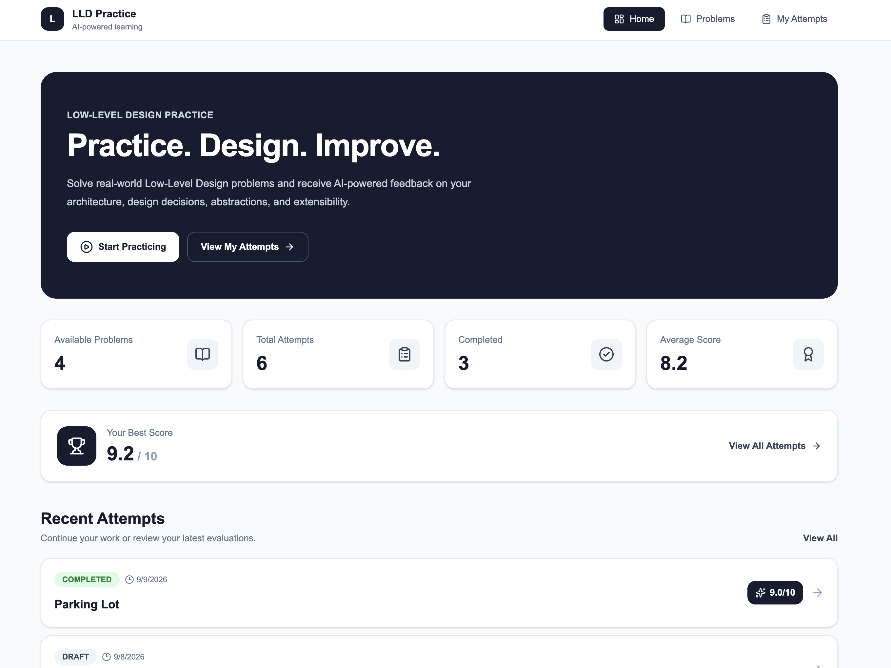

# 🧠 LLD Practice Platform

A modern full-stack **Low-Level Design practice platform** where users can solve real-world LLD problems, submit their designs, and receive **AI-powered evaluations and feedback**.

## 🚀 Features

* Browse Low-Level Design problems
* Search and filter problems by difficulty
* Create and manage design attempts
* Save submissions as drafts
* Structured LLD solution sections
* AI-powered design evaluation
* Overall score and detailed feedback
* Evaluation retry support
* View previous attempts and progress
* Responsive desktop and mobile interface
* Clean and modern Tailwind CSS UI

## 🏗️ Tech Stack

### Frontend

* Next.js
* TypeScript
* Tailwind CSS
* Axios
* Lucide Icons

### Backend

* NestJS
* TypeORM
* PostgreSQL
* Swagger

## ⚙️ Installation

Installation instructions are available separately:

* Frontend: [`frontend/installation.md`](./frontend/INSTALLATION.md)
* Backend: [`backend/installation.md`](./backend/INSTALLATION.md)

## 👨‍💻 Author

**Dheerendra**

## 📄 License

This project is created for learning and portfolio purposes.
